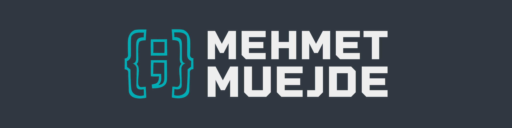
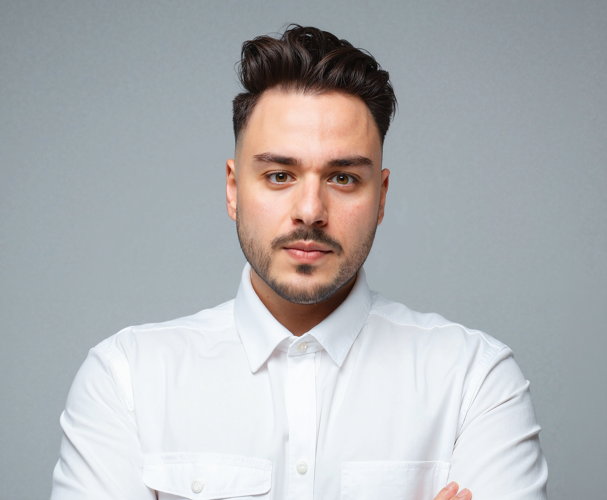

  

  

<h1 align="center">Hi, I’m Mehmet Müjde (@mehmetmuejde) 👋</h1>

  Senior Full-Stack & AI Engineer
   
  <strong>Taking software and AI from prototype to production</strong>

---

### 🧠 About Me

- 👨‍💻 For more than 15 years, I have been building **web, mobile and desktop applications** as a **senior full-stack developer** – from requirements analysis through architecture and development to operations and handover
- 🛠️ My technical home is **Python**, **TypeScript** and **Rust**, with **React** in the frontend and **FastAPI** in the backend
- ⚙️ As an AI engineer, I build **agentic systems** and **AI agents** and drive **agentic software development** with AI-assisted code and security reviews
- 🤝 My clients include **DEUTZ AG**, **ENERCON GmbH** and **dmTECH GmbH (dmGPT)** – I work remotely, on my own or in interdisciplinary teams
- 🎓 Studied **Mechatronics** & **Computer Science** · Currently pursuing a part-time **M.Sc. in Data Science @ RWTH Aachen University**
- 🏍️ Away from the keyboard, I love riding motorcycles – my bike is a **2026 Harley-Davidson Breakout**

---

### 📄 Portfolio

- 🇬🇧 English: [portfolio-en.pdf](https://portfolio.cdn.mehmetmuejde.com/portfolio-en.pdf)
- 🇩🇪 Deutsch: [portfolio-de.pdf](https://portfolio.cdn.mehmetmuejde.com/portfolio-de.pdf)

---

### 📫 Let's Connect

- 🌐 Website: [www.mehmetmuejde.com](https://www.mehmetmuejde.com)  
- 📧 Email: [freelancer@mehmetmuejde.com](mailto:freelancer@mehmetmuejde.com)  
- 💼 LinkedIn: [linkedin.com/in/mehmetmuejde](https://www.linkedin.com/in/mehmetmuejde)

---
